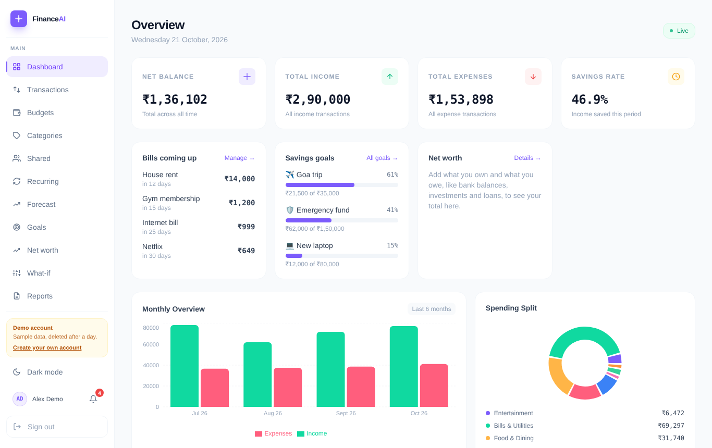
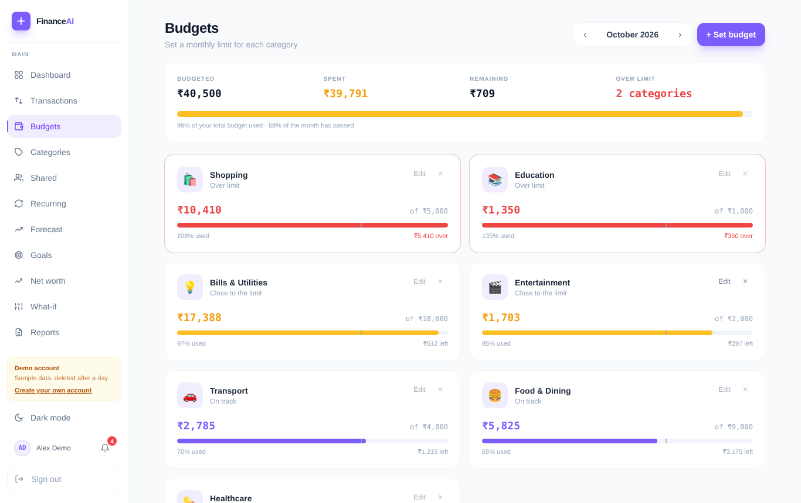
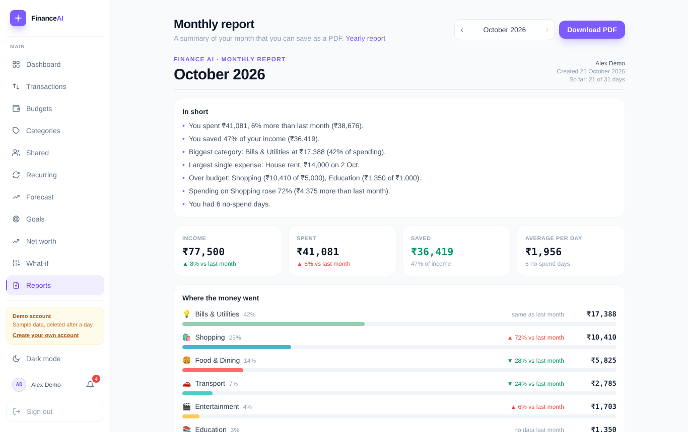
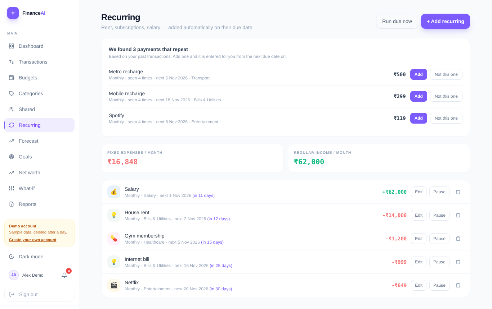
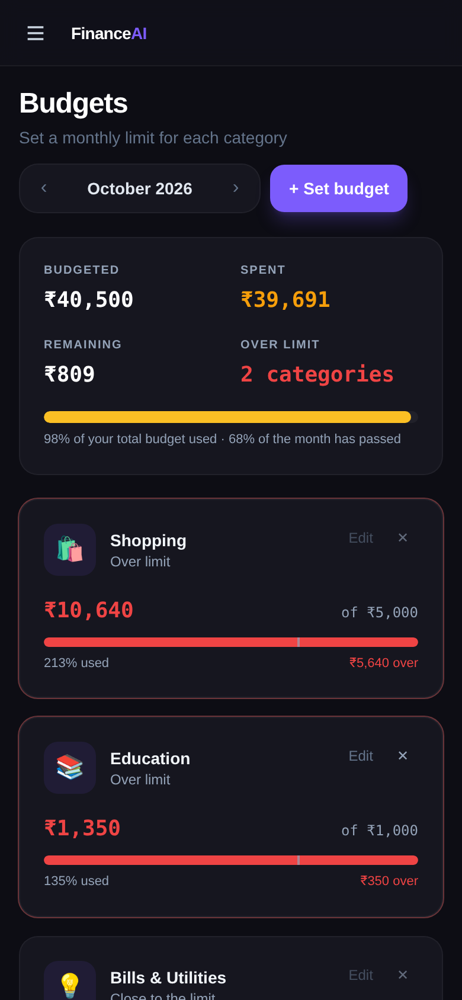

# Finance AI

[](https://github.com/Surajkumar40/ai-finance-agent/actions/workflows/ci.yml)

A full-stack personal finance tracker with an AI assistant. Track spending, set budgets, save towards goals, share expenses with a household, and get plain-language answers about your money.

**[Live demo](https://ai-finance-agent-beryl.vercel.app/login)**: click **"Try the demo, no sign-up needed"** to explore a fully populated account in one click.

> The API runs on a free hosting tier that sleeps when idle, so the very first request after a quiet period can take 30 to 60 seconds. After that it is fast.

<p align="center">
  
</p>

<table>
  <tr>
    <td width="50%"></td>
    <td width="50%"></td>
  </tr>
  <tr>
    <td width="50%"></td>
    <td width="50%" align="center"></td>
  </tr>
</table>

## What it does

**Money tracking**
- Add, edit, duplicate and delete transactions, with search, filters (type, date range, category), sorting and paging.
- Select many at once to delete or re-categorise them, with a one-click **Undo** after a delete.
- Import and export CSV. Scan a receipt photo to fill in the form. Add a transaction by speaking.
- Custom categories with their own colours and icons.

**Planning**
- **Budgets** per category and month, with progress bars, alerts at 80% and 100%, a "copy last month" button, and suggested limits based on your last three months.
- **Recurring items** (rent, salary, subscriptions) that are added automatically on their due date. The app also **spots repeating payments in your history** and offers to turn them into recurring items in one tap.
- **Savings goals** with contributions and a projection of when you will reach each one at your current pace.
- **Net worth** from assets and liabilities, with a history chart.
- **Forecast** and a **what-if simulator** to see where the month is heading.

**Sharing**
- Create a household, invite members, set shared budgets, split expenses and settle up.

**Insight**
- Dashboard with bills coming up, goals, net worth, spending split and a monthly overview.
- Monthly and yearly reports (download as PDF) written in plain language: what changed, what went over budget, how many no-spend days.
- Financial health score and an AI chat assistant that can look up your spending, add transactions and set budgets for you.

**Everything else**
- Sign up and login, password reset by email, download all your data, delete your account.
- Bill reminder emails, in-app notifications, dark mode, installable on a phone (PWA) with an offline page.
- A "Get started" checklist for new accounts, and temporary demo accounts that delete themselves after 24 hours.

## Tech stack

| Layer | Technology |
|---|---|
| Frontend | React 19, Vite 8, React Router 7, Tailwind CSS 3, Recharts, Axios |
| Backend | Node.js, Express 5, mysql2 |
| Database | MySQL |
| Auth | bcrypt password hashing, JWT with a per-user token version |
| AI | Anthropic Claude (tool use and vision) with Groq as a backup provider |
| Email | Brevo or Resend (REST) |
| Hosting | Vercel (frontend), Render (API), Aiven (MySQL) |

## How it fits together

```
 Browser (React app, installable PWA)
        │  HTTPS, JSON, Bearer token
        ▼
 Express API  ── rate limits · security headers · CORS allow-list · input checks
   routes/*.js   one file per area, mounted automatically at /api/<name>
   services/*.js business logic, mostly plain functions with no database access
        │                      │                         │
        ▼                      ▼                         ▼
     MySQL            Claude / Groq (AI)         Brevo / Resend (email)

 Hourly timer in the server adds due recurring transactions.
 A key-protected endpoint (/api/cron/reminders) sends the daily bill reminders.
```

## Engineering notes

- **Security.** Passwords are hashed with bcrypt. Sign-in tokens carry a per-user version, so changing the password signs out every other device at once. Every route has a rate limit, with tighter ones on login, sign-up, AI and receipt scanning. Responses carry security headers, CORS is limited to the app's own address, user input always reaches SQL through placeholders, and internal error details are never sent to the browser. CSV exports are protected against spreadsheet formula injection.
- **Dates that stay correct in any timezone.** Dates travel as plain `YYYY-MM-DD` text and are never converted through a timestamp, so a transaction on the 1st stays in its month for users anywhere in the world.
- **Logic kept apart from the database.** Recurring-payment detection, budget suggestions, goal projections and expense splitting are plain functions with no database calls, which makes them easy to test and reason about.
- **Demo mode.** `POST /api/demo` creates a temporary account with realistic data, limits how many can be created per hour, and removes them after a day.
- **Tested on every push.** 106 automated tests run on GitHub Actions (see Tests below), and two of them guard the points that matter most: dates never shifting a day, and one person never seeing another's data.
- **Trade-off.** Rate limits are held in memory, which is right for a single server. Running several API instances would need a shared store such as Redis.

## Run it on your computer

You need **Node.js 20.19+ (or 22+)** and **MySQL 8**.

```bash
git clone https://github.com/Surajkumar40/ai-finance-agent.git
cd ai-finance-agent
```

**1. Database and API**

```bash
mysql -u root -p < backend/database/schema.sql     # creates the finance_tracker database
cd backend
npm install
cp .env.example .env                               # then open .env and fill in your values
node database/migrate.js                           # creates the remaining tables
npm run dev                                        # API on http://localhost:5000
```

Other tables, such as households and net worth, are created automatically the first time they are used.

**2. Web app** (in a second terminal)

```bash
cd frontend
npm install
npm run dev                                        # app on http://localhost:5173
```

The app talks to `http://localhost:5000` by default. To point it somewhere else, create `frontend/.env` containing `VITE_API_URL=https://your-api-address`.

Open http://localhost:5173 and use **Try the demo**, or sign up.

### Tests

106 automated tests run on every push (GitHub Actions) next to a lint and build check of the web app:

- **18 unit tests** for the business logic: next due dates, splitting expenses, budget suggestions, goal projections and spotting repeating payments.
- **75 web app tests** (Vitest and Testing Library) for CSV export and import, rupee formatting, voice-entry parsing, the what-if calculator, the light/dark theme and the sign-in form. They also cover the mobile menu behaviour. A date test runs in a different time zone on purpose, to catch dates shifting a day.
- **13 end-to-end tests** that start the real API against a real MySQL database and check sign-in, privacy between users, transactions, bulk delete and undo, budgets, goals, recurring items, the demo account and data export.

```bash
cd backend
npm run test:unit    # unit tests only (needs just the .env file)
npm test             # unit tests, then end-to-end tests (needs the database from step 1)
```

### Settings (`backend/.env`)

| Setting | Needed? | Purpose |
|---|---|---|
| `DB_HOST`, `DB_PORT`, `DB_USER`, `DB_PASSWORD`, `DB_NAME` | Yes | MySQL connection |
| `JWT_SECRET` | Yes | Signs login tokens. Use 64 or more random characters |
| `PORT` | No | API port (default 5000) |
| `FRONTEND_URL` | In production | The web app's address. Locks CORS to it and is used in email links |
| `CORS_ORIGINS` | No | Extra allowed addresses, comma separated |
| `ANTHROPIC_API_KEY`, `GROQ_API_KEY` | For AI features | Chat assistant, auto-categorising, receipt scanning (receipts need Claude) |
| `AI_PROVIDER` | No | Set to `groq` to use Groq first |
| `BREVO_API_KEY` or `RESEND_API_KEY`, plus `MAIL_FROM_EMAIL` | For email | Password reset and bill reminders |
| `CRON_KEY` | For daily reminders | Secret (20+ characters) that protects `/api/cron/reminders` |

Without the AI or email keys the rest of the app works normally.

## Project layout

```
backend/
  server.js           app setup, rate limits, route loading, hourly scheduler
  routes/             one file per feature area (transactions, budgets, goals, ...)
  services/           business logic (recurring detection, budget suggestions, ...)
  middleware/         auth, rate limiting, security headers, CORS
  database/           schema.sql, migrate.js
  tests/              unit and end-to-end tests
frontend/
  src/pages/          one page per screen
  src/components/     shared UI (layout, dashboard widgets, charts, entry helpers)
  src/utils/          currency, CSV, voice parsing, what-if maths
docs/screenshots/     images used in this README
.github/workflows/   automatic checks that run on every push
```

## Deployment

- **Frontend:** Vercel, project root `frontend`, environment variable `VITE_API_URL` set to the API address. `frontend/vercel.json` sends every path to the app so page refreshes work.
- **API:** Render web service, root `backend`, build `npm install`, start `npm start`, with the settings above.
- **Database:** Aiven MySQL. Run `schema.sql` and then `node database/migrate.js` once against it.

---

Built by [@Surajkumar40](https://github.com/Surajkumar40).